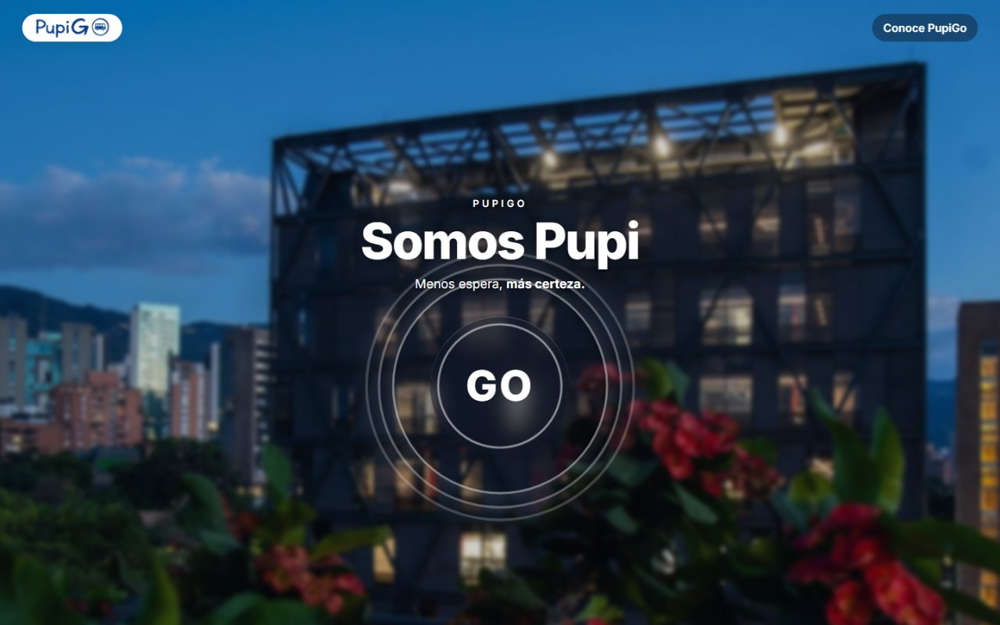
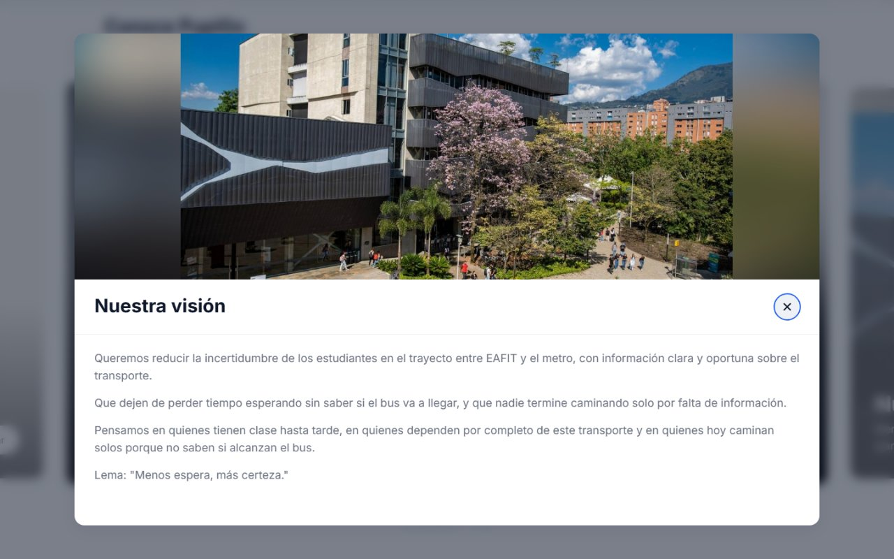
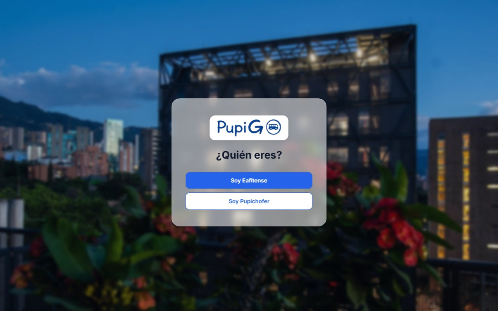
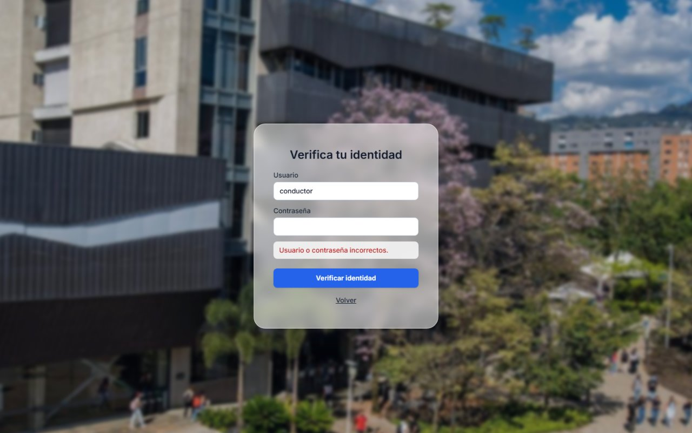
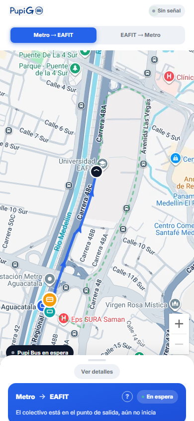
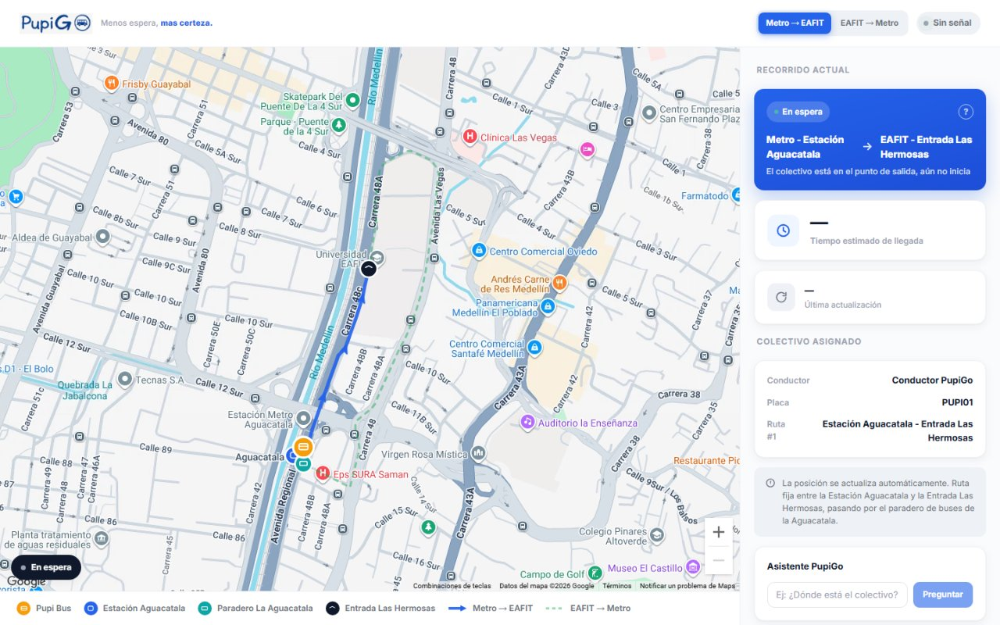
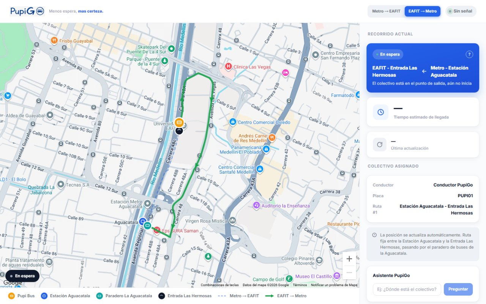

# PupiGo | Proyecto Integrador 1 (PI1)

## Table of Contents
1. [Description](#description)
   1. [Context](#context)
   2. [Problem](#problem)
   3. [Proposed Solution](#proposed-solution)
2. [Product Vision](#product-vision)
3. [Target Group](#target-group)
4. [Needs](#needs)
5. [Business Goals](#business-goals)
6. [Alternative Solutions](#alternative-solutions)
7. [MVP Scope](#mvp-scope)
8. [PupiGo Version 2](#pupigo-version-2)
   1. [Motivation](#motivation)
   2. [Features](#features)
   3. [Version 1 Issues Fixed](#version-1-issues-fixed)
   4. [Design Refinements](#design-refinements)
   5. [Screenshots](#screenshots)
9. [Domain Model](#domain-model)
10. [How to Run](#how-to-run)
    1. [Run with Docker](#run-with-docker)
       1. [Install Git and Docker Desktop](#install-git-and-docker-desktop)
       2. [Check Docker](#check-docker)
       3. [Get the Code](#get-the-code)
       4. [Start the App](#start-the-app)
       5. [Open the App](#open-the-app)
       6. [Stop the App](#stop-the-app)
       7. [Update to a New Version](#update-to-a-new-version)
       8. [Customize Settings (optional)](#customize-settings-optional)
       9. [Common Problems](#common-problems)
    2. [Local development (without Docker)](#local-development-without-docker)
       1. [Requirements](#requirements)
       2. [Repository Structure](#repository-structure)
       3. [Backend](#backend)
       4. [Environment Variables](#environment-variables)
       5. [Frontend](#frontend)
       6. [Tests](#tests)
       7. [Access Routes](#access-routes)
       8. [Trying a Full Trip](#trying-a-full-trip)
       9. [Troubleshooting](#troubleshooting)
       10. [Technical Decisions](#technical-decisions)
11. [Project Management](#project-management)
12. [Authors](#authors)
13. [Course Information](#course-information)

## Description

### Context

For several semesters, the EAFIT University student community has reported a sustained increase in robbery incidents along the route connecting the university with the metro station, particularly during the afternoon and evening hours. Students raised their concerns with university leadership, pointing out that these incidents not only caused economic harm but also directly affected the emotional stability of those involved and generated a widespread sense of insecurity and fear among everyone who had to travel that route daily.

As a first response, the student community itself organized an informal accompaniment group known as **"Caminantes"**, where students coordinated their departures by chat, agreed on a meeting point, and walked the route together. Once it became clear that this measure did not solve the underlying problem, the community requested additional support from the city government and the university's security staff, which considerably reduced the number of robberies.

However, the solution that ultimately became the most viable for providing calm and safety was transportation managed by the university itself: initially a van with limited capacity, nicknamed by the community as the **"Pupi móvil"**, which covered routes at certain times, and which later evolved into a higher-capacity collective bus (**"el colectivo"**). This solution is still managed completely informally through the WhatsApp group **"Caminantes EAFIT"**, where students ask via a sticker that reads *"¿Por dónde pasa el Pupi móvil?"* ("Where is the Pupi móvil right now?") and wait for someone who has the information to reply.

This dynamic means that students waiting at the meeting points, whether at the university, next to **Las Hermosas**, or at the metro station's stop, depend entirely on someone informed responding in the group in order to make a decision. As a result, they don't know for certain when the bus will arrive, they lose time waiting without reliable information, and in many cases end up walking alone rather than risk missing the transport, exposing themselves again to the very risk that started the whole problem.

### Problem

With the purpose of reducing the uncertainty and waiting times of students who depend on the EAFIT-metro transportation service, the student community requested the development of an information system that provides real-time visibility of the transport, replacing informal chat-based coordination with a formal web platform.

The system must allow **users** to be registered, who can create an account on the platform by providing information such as a unique identifier, full name, institutional email, password, role (student, driver, or administrator), and registration date.

The system will include **collectives** (buses), representing the vehicles assigned to the transport service, uniquely identified by a license plate or internal identifier. Each collective will store information such as its passenger capacity and its status (active or inactive). Each collective may have a **driver** assigned per shift, linked to a system user with the corresponding role.

The system will allow **routes** to be defined, identified by a unique code, describing the path the transport follows between an origin point and a destination point, along with its regular operating schedule. Each route will be made up of one or more **stops**, understood as the meeting points recognized by the community (for example, **Las Hermosas** or the metro stop), identified by a name and its geographic location.

Every time a collective covers a route at a given time, the system will record a **trip**, uniquely identified, storing the associated route, the assigned collective, the driver in charge, the start time, the end time, and its status (in progress, finished, or cancelled). During each trip, the system will periodically capture the collective's **real-time location**, recording latitude, longitude, and the corresponding timestamp, in order to show its position on the map to users who are waiting.

Users will be able to receive **notifications** related to a specific trip, for example when the collective is close to their stop or when there is a change to the usual route. They will also be able to generate **incident reports**, recording the type of incident, a description, the location where it occurred, and the date, in order to keep the community informed about relevant events during the route.

The system will also allow users to check their **trip history**, i.e., the trips they have previously followed or used through the platform.

In a later phase, the system must support seat management through **reservations**, identified by a unique code, linking a user to a specific trip and recording its status (confirmed, waitlisted, or cancelled). Each confirmed reservation may have an associated **QR code validation**, recording the generated code and the timestamp at which the driver validated the passenger's boarding.

### Proposed Solution

**PupiGo** is a web application, accessible from a URL with no installation required, that replaces informal chat-based coordination with a formal, real-time visibility system for the EAFIT-metro transport service. On an illustrated map, students can see the collective's current location, the route it is following and the estimated arrival time; the driver shares the location from the browser.

The solution is built incrementally across sprints (plan as recorded in the [GitHub Project](https://github.com/users/migueCOLORADO/projects/4)):

- **Sprint 1:** product vision, domain model and mockup.
- **Sprint 2 (v1.0):** manage a trip and share location (UH1), view the shuttle's status and location (UH2), periodic GPS updates (UH3), GPS permission handling (UH5) and trip cancellation (UH8).
- **Sprint 3:** last known position (UH4), fixed EAFIT-Metro route with stops (UH6), shuttle direction with driver, plate and route (UH7), brand identity and usable interface (UH9) and an AI assistant for questions about the shuttle (UH10).
- **Sprint 4 (planned):** estimated time of arrival to a stop (Feature 11), user authentication (Feature 12), notifications (Feature 13), administration of routes, vehicles and drivers (Feature 14) and trip history (Feature 15).

## Product Vision

Our motivation is to reduce the uncertainty that students experience on their trip between EAFIT and the metro, giving them clear and timely access to the information they need to know what to expect. We want them to stop losing time waiting without knowing whether the bus will arrive or not, and for that waiting and travel time to be reduced by having real, accessible information exactly when they need it. The positive change we want to achieve is for students to be able to plan their departure with certainty, without depending on blindly coordinating with other classmates or taking risks due to lack of information.

**"Menos espera, más certeza."** *(Less waiting, more certainty.)*

*(See the Product Vision Board in [`Product Vision/Product Vision Board 3.png`](https://github.com/migueCOLORADO/PupiGo/blob/Sprint-1/Product%20Vision/Product%20Vision%20Board%203.png) on the `Sprint-1` branch.)*

## Target Group

We are targeting EAFIT students who use the transport service (**el colectivo**, formerly the **"Pupi móvil"**) to travel between the university and the metro station, especially during the afternoon and evening hours, which carry the highest risk. In particular, we are thinking of students who have classes until late, students who fully depend on this transport because they have no other safe alternative, and students who currently end up walking alone because they don't know whether they'll make it in time to catch the bus.

## Needs

The problem we are solving is the lack of real-time information about the transport: students don't know for certain when the bus will arrive, they lose time waiting without knowing whether it's worth staying or walking, and they often end up making the trip alone rather than risk missing it. The benefit we offer is reducing that uncertainty and that risk exposure, giving them real visibility into where the bus is, which route it's following, and how much longer until it arrives.

## Business Goals

For the university, this app represents a direct benefit to student wellbeing and safety, which is precisely what has driven all the prior investment in **Caminantes** and **el colectivo**. The business goals are: reduce the perception of insecurity and complaints related to the EAFIT-metro route, increase students' trust in the existing transport service, and, over time, through the administrative panel, give those who manage the service real data on routes and schedules to optimize resources.

## Alternative Solutions

The solution considered most viable for providing calm and safety was implementing what was initially named the **"Pupi móvil"**, a van with limited seating that covered routes at certain times. It was later replaced with a higher-capacity collective bus. This is managed through the group called **"Caminantes EAFIT"**, where people ask via a sticker that reads *"Por donde pasa el Pupi móvil"* against a background image of the famous van nicknamed by the community. Through this, people waiting at the university stops (next to **Las Hermosas**) or at the metro (next to the stop by the station) manage to "find out" the transport's location and make decisions accordingly. However, to this day there is no app or formal system that gives them real visibility of the transport; everything depends on someone with the information responding to the sticker in the group and letting those waiting know.

## MVP Scope

Domain entities implemented in the backend (`backend/tracking/models.py`):

- **Route**: fixed route with origin and destination (name and coordinates).
- **Stop**: stops of a route, in order.
- **Vehicle**: plate and name of the shuttle.
- **Driver**: driver name.
- **Trip**: route, vehicle, driver, direction (Metro to EAFIT or EAFIT to Metro) and status (waiting, in progress, completed, cancelled).
- **Position**: GPS readings of a trip (latitude, longitude, timestamp).

Not implemented yet (later phases): users and authentication, notifications, incident reports, trip history, reservations and QR code validation.

## PupiGo Version 2

### Motivation

Version 1 proved the core idea (a live view of the EAFIT-metro shuttle), but using it on real phones and in the deployed app exposed problems that broke the main promise of "less waiting, more certainty": the driver could not share the location, the map was hidden on mobile, the desktop view showed a blank area and the assistant displayed a technical notice. Version 2 fixes those problems and also covers needs that version 1 left open:

- **A clear entry point.** A visitor who opens the PupiGo link now lands on a page that explains what the app is and lets them enter with a single tap.
- **Access by role.** Students enter without credentials; only the verified driver can open the driver view and broadcast the trip. The visible "Iniciar sesión" buttons are gone.
- **The map always in sight.** On mobile, the details card no longer covers the map, and no view of the app has page scroll.
- **A real map limited to the area.** The shuttle is shown on a real map that cannot leave the area of the routes, with both routes drawn along the real streets.
- **Location and assistant without friction.** The browser asks for the location permission when the driver starts a trip, and the assistant answers as "Asistente PupiGo" without technical notices.

### Features

The base of the driver verification is the token authentication of Feature 12 ([#129](https://github.com/migueCOLORADO/PupiGo/issues/129)).

| Feature | Issue | Goal | Requirements covered |
|---|---|---|---|
| F16 Landing page Somos Pupi | [#218](https://github.com/migueCOLORADO/PupiGo/issues/218) (UH16 [#219](https://github.com/migueCOLORADO/PupiGo/issues/219)) | Give visitors a clear and attractive home page that explains PupiGo and opens the app with one click | [#220](https://github.com/migueCOLORADO/PupiGo/issues/220) "Somos Pupi" header with background photo, [#221](https://github.com/migueCOLORADO/PupiGo/issues/221) animated GO button that leads to the role selection, [#222](https://github.com/migueCOLORADO/PupiGo/issues/222) information carousel, [#223](https://github.com/migueCOLORADO/PupiGo/issues/223) card detail in a modal, NFR [#224](https://github.com/migueCOLORADO/PupiGo/issues/224) no overflow on mobile and desktop |
| F17 Role selection and driver access | [#225](https://github.com/migueCOLORADO/PupiGo/issues/225) (UH17 [#226](https://github.com/migueCOLORADO/PupiGo/issues/226)) | Let each user choose "student" or "driver" on entry, and let only the verified driver broadcast the trip | [#227](https://github.com/migueCOLORADO/PupiGo/issues/227) role selection view (`/auth0`), [#228](https://github.com/migueCOLORADO/PupiGo/issues/228) driver verification with predefined credentials (`/auth0-cond`), [#229](https://github.com/migueCOLORADO/PupiGo/issues/229) driver view restricted to the verified driver, [#230](https://github.com/migueCOLORADO/PupiGo/issues/230) login buttons removed from the app views, NFR [#231](https://github.com/migueCOLORADO/PupiGo/issues/231) hashed passwords never stored in the repository, NFR [#232](https://github.com/migueCOLORADO/PupiGo/issues/232) generic error message |
| F18 Mobile view with the map always visible | [#233](https://github.com/migueCOLORADO/PupiGo/issues/233) (UH18 [#234](https://github.com/migueCOLORADO/PupiGo/issues/234)) | Keep the map visible on mobile while the trip details stay one gesture away | [#235](https://github.com/migueCOLORADO/PupiGo/issues/235) draggable bottom card, [#236](https://github.com/migueCOLORADO/PupiGo/issues/236) button to expand and collapse the card, [#237](https://github.com/migueCOLORADO/PupiGo/issues/237) no blank space at the end of the page on desktop, NFR [#239](https://github.com/migueCOLORADO/PupiGo/issues/239) app views without page scroll, NFR [#238](https://github.com/migueCOLORADO/PupiGo/issues/238) phones from 360 to 430 px (verified in emulation; real devices pending) |
| F19 Location permission and Asistente PupiGo | [#240](https://github.com/migueCOLORADO/PupiGo/issues/240) (UH19 [#241](https://github.com/migueCOLORADO/PupiGo/issues/241)) | Ask for the location permission when it is needed and show an assistant without technical notices | [#242](https://github.com/migueCOLORADO/PupiGo/issues/242) keep the integration with the AI provider, [#243](https://github.com/migueCOLORADO/PupiGo/issues/243) ask for the location permission when a trip starts, [#244](https://github.com/migueCOLORADO/PupiGo/issues/244) "Asistente PupiGo" without technical notices, NFR [#245](https://github.com/migueCOLORADO/PupiGo/issues/245) no secrets in the repository. [#246](https://github.com/migueCOLORADO/PupiGo/issues/246) (renewable certificate) was closed as out of scope |
| F20 Map limited to the area with a geolocation API | [#247](https://github.com/migueCOLORADO/PupiGo/issues/247) (UH20 [#248](https://github.com/migueCOLORADO/PupiGo/issues/248)) | Show the shuttle on a real map limited to the area of the routes | [#249](https://github.com/migueCOLORADO/PupiGo/issues/249) map integrated with the geolocation API (Google Maps), [#250](https://github.com/migueCOLORADO/PupiGo/issues/250) map limited to the area of the routes, [#251](https://github.com/migueCOLORADO/PupiGo/issues/251) outbound and return routes drawn, [#252](https://github.com/migueCOLORADO/PupiGo/issues/252) SVG map as fallback when there is no key, NFR [#253](https://github.com/migueCOLORADO/PupiGo/issues/253) API key in environment variables (domain restriction pending) |

### Version 1 Issues Fixed

| Issue in version 1 | Cause | Fix in version 2 |
|---|---|---|
| In the deployed app the browser did not ask for the location permission, so the driver could not share the GPS position | Browsers only expose geolocation in a secure context (HTTPS or `localhost`), and the driver view did not request the permission at a clear moment | **Iniciar recorrido** now requests the permission and calls the API only if it is granted. If the context is not secure, there is no GPS or the permission is denied, the driver sees a message that explains how to enable the location. Serving the app over HTTPS remains a deployment step |
| On mobile the details card covered the map and could not be moved down | The details card was laid over the map with no way to drag or collapse it | Draggable bottom card that starts collapsed (the map keeps at least 60 % of the screen; 84 % measured at 390x844), with a **Ver detalles** / **Ocultar detalles** button as an alternative to dragging |
| On desktop a white box appeared when scrolling | The `.sr-only` label of the assistant was absolutely positioned without a positioned container, escaped the overflow and made the page 69 px taller | The label is contained and the app views have no page scroll (at 1440x900, `scrollHeight` went from 969 to 900) |
| The assistant showed a technical notice about its automatic mode | The panel displayed the backend `notice` | The panel is titled "Asistente PupiGo" and hides the notice; with no AI provider configured it still answers with the trip status, and with the key it uses the provider without code changes |

Other changes in version 2: login only for the driver, reached from a role selection screen (the old `/login` route was removed); the new landing page; and a real map limited to the area, with the routes drawn along the streets.

### Design Refinements

After the first build, the design went through two rounds of adjustments.

**Landing page (Apple style)**
- Fixed EAFIT photos as background. The header has no box: white text with a soft shadow over a light dark veil, with WCAG AA contrast measured on the worst background pixel (title 5.6:1 or more, slogan 7.0:1 or more).
- Top bar with the PupiGo logo (link to `/`) and a **Conoce PupiGo** link that scrolls smoothly to the carousel section.
- The header fades into the "Conoce PupiGo" section with a gradient, without a straight cut.
- Apple-style carousel, 20 % taller in the second round: arrows on desktop and swipe on mobile. The card detail opens with an animation and a blurred backdrop.
- Image scaling with a focal point per image; when an image is smaller than its slot or its ratio differs too much, it is shown whole over a blurred copy of itself.

**GO button and transition**
- Larger GO button (about 40 % bigger). On hover, a ring fills from red to orange to green and stays full; when the pointer leaves, it drains from where it was and hides. The ring also works with "reduce motion" enabled in the system.
- Tapping GO plays a console-style transition: concentric rings expand from the button, the header zooms out to black, and `/auth0` enters from black with its background coming into focus. With "reduce motion", it is a 200 ms fade.
- `/auth0` and `/auth0-cond` share the landing background with a blurred photo and a frosted glass panel.

**Map: real routes, markers and legend**
- The outbound route (Metro → EAFIT) and the return route (EAFIT → Metro) follow the real streets with fixed geometry taken from OpenStreetMap (ODbL). The selected direction is drawn solid with arrows and the other one dotted.
- Markers consistent with the legend: Estación Aguacatala, Paradero La Aguacatala (start of the outbound route and end of the return route) and Entrada Las Hermosas (end of the outbound route and start of the return route).
- A waiting trip without GPS shows the bus at the start of the selected route; with GPS, it is shown where it reports.
- The legend lists "Metro → EAFIT" and "EAFIT → Metro" with the real color and style of each line, and only the entries that are on the map. The SVG fallback map keeps its own legend.

### Screenshots

**Landing page on desktop**


**Landing page on mobile**


**GO button: hover ring and transition on tap**




**Card detail**



**Role selection (`/auth0`)**



**Driver verification (`/auth0-cond`)**



**Student view on mobile with the card collapsed**



**Map: outbound and return routes**





## Domain Model

The current relational data model, with entities, attributes and cardinalities, is in the wiki: [1.3. Data Model](https://github.com/migueCOLORADO/PupiGo/wiki/1.-Architecture-and-Data#13-data-model). The deployment and component diagrams are on the same page.

The original domain model of Sprint 1 is kept in [`Diagrams/domainDPupiGo.pdf`](https://github.com/migueCOLORADO/PupiGo/blob/Sprint-1/Diagrams/domainDPupiGo.pdf) on the `Sprint-1` branch.

## How to Run

PupiGo runs as two Docker containers, so the fastest way to see the app exactly as it was delivered is Docker: you do not need Python, Node.js or any API key. The steps below start from a computer without Docker. If you prefer to run the backend and the frontend by hand, go to [Local development (without Docker)](#local-development-without-docker).

| Container | What it runs |
|---|---|
| `pupigo-backend` | Django + Django REST Framework served by Gunicorn, with a healthcheck on `/api/`. At startup it applies the migrations and loads the base data and the demo users |
| `pupigo-frontend` | Nginx serving the Vite build of the React app and forwarding `/api/`, `/admin/` and `/static/` to the backend. Published on port `80` of your computer (`APP_PORT`) |

### Run with Docker

#### Install Git and Docker Desktop

Install Git from [git-scm.com/downloads](https://git-scm.com/downloads) and then Docker for your operating system.

**Windows 10/11.** Docker Desktop uses WSL 2. Open PowerShell as administrator and run one of these commands; `--install` sets up WSL the first time and `--update` updates an existing installation. Restart the computer when it finishes.

```powershell
wsl --install
wsl --update
```

Then install [Docker Desktop for Windows](https://docs.docker.com/desktop/setup/install/windows-install/) keeping the WSL 2 option selected, open Docker Desktop and wait until the bottom left corner shows **Engine running**.

**macOS.** Install [Docker Desktop for Mac](https://docs.docker.com/desktop/setup/install/mac-install/) (choose Apple silicon or Intel), open it and wait until it shows **Engine running**.

**Linux.** Install [Docker Desktop for Linux](https://docs.docker.com/desktop/setup/install/linux/) or [Docker Engine](https://docs.docker.com/engine/install/) with the Compose plugin. With Docker Engine, follow the [post-installation steps](https://docs.docker.com/engine/install/linux-postinstall/) to run `docker` without `sudo`.

#### Check Docker

This command prints a `Client` section and a `Server` section; if the `Server` section shows an error, the engine is not running yet.

```bash
docker version
```

This command downloads a tiny test image, prints a message that starts with `Hello from Docker!` and removes the container.

```bash
docker run --rm hello-world
```

#### Get the Code

These commands download the repository into a `PupiGo` folder and enter it. Git prints `Cloning into 'PupiGo'...` and finishes without errors.

```bash
git clone https://github.com/migueCOLORADO/PupiGo.git
cd PupiGo
```

#### Start the App

This command builds both images and starts the containers in the background. The first time it takes a few minutes because it downloads the base images and installs the dependencies; it ends with `Container pupigo-backend Healthy` and `Container pupigo-frontend Started`. No `.env` file is needed.

```bash
docker compose up -d --build
```

This command lists the containers. Run it again until both show `Up` and `(healthy)` in the `STATUS` column; right after starting, the frontend can show `(health: starting)` for about 15 seconds.

```bash
docker compose ps
```

If a container does not become healthy, `docker compose logs backend` (or `frontend`) shows the reason.

#### Open the App

Open `http://localhost` in the browser and follow the app:

1. `/` is the landing page. Press **GO**.
2. `/auth0` asks **¿Quién eres?**. **Soy Eafitense** opens the student view and **Soy Pupichofer** opens the driver sign-in.
3. `/estudiante` is the student view: trip status, map, assigned shuttle and AI assistant. It does not need an account.
4. `/auth0-cond` is the driver sign-in. Use the demo account below and press **Verificar identidad**.
5. `/conductor` is the driver view: create, start, finish or cancel the trip and share the GPS location (the browser asks for location permission). Without a driver session it sends you to `/auth0-cond`; **Salir** closes the session.

| Demo driver account | Value |
|---|---|
| User | `conductor` |
| Password | `PupiGo2026` |

To follow a complete trip with both views open, see [Trying a Full Trip](#trying-a-full-trip).

#### Stop the App

This command stops and removes the containers; the database is kept in the `pupigo-data` volume, so the trips are still there the next time you start the app.

```bash
docker compose down
```

`docker compose down -v` also removes the volumes, which deletes the database. The next start creates it again with only the base data and the demo users.

#### Update to a New Version

These commands download the latest changes of the branch and rebuild the images; the containers are replaced and the database is kept.

```bash
git pull
docker compose up -d --build
```

#### Customize Settings (optional)

The app works without a `.env` file. To change a value, copy `.env.example` (in the repository root) to `.env`, edit it and run `docker compose up -d --build` again. `.env` is ignored by Git, so it is never uploaded.

macOS, Linux or Git Bash:

```bash
cp .env.example .env
```

Windows PowerShell:

```powershell
Copy-Item .env.example .env
```

| Variable | Default | Use |
|---|---|---|
| `APP_PORT` | `80` | Port of your computer where the app is published |
| `PUPIGO_DEMO_PASSWORD` | `PupiGo2026` | Password of the demo users `conductor` and `estudiante`, applied at every start |
| `VITE_GOOGLE_MAPS_API_KEY` | Maps Demo Key | Google Maps browser key, built into the frontend image (a change needs `--build`) |
| `DJANGO_SECRET_KEY` | empty | Django secret key; if empty, the backend generates one at startup |
| `DJANGO_DEBUG` | `0` | `1` turns on Django debug mode (development only) |
| `ASSISTANT_API_KEY`, `ASSISTANT_MODEL` | empty | AI provider key and model for the assistant; empty means automatic mode |
| `TAG`, `DOCKERHUB_USER` | `v2`, empty | Name of the images: `<DOCKERHUB_USER>/pupigo-backend:<TAG>` (`pupigo` when empty) |

#### Common Problems

**Port 80 is already in use.** `docker compose up` fails with `port is already allocated` or `bind: address already in use`. Create the `.env` file, set `APP_PORT=8080`, run `docker compose up -d --build` and open `http://localhost:8080`.

**`Cannot connect to the Docker daemon` or `error during connect`.** The engine is off. Open Docker Desktop, wait for **Engine running** and repeat the command.

**Docker Desktop on Windows says that WSL is outdated or does not start.** Run `wsl --update` in PowerShell as administrator, restart the computer and open Docker Desktop again.

**The map shows the illustrated map instead of Google Maps.** The shared demo key has a daily usage limit; when it is used up, the app shows the SVG backup map, which keeps the same route, stops and shuttle position. It works again the next day, or you can set your own `VITE_GOOGLE_MAPS_API_KEY` in `.env` and rebuild.

**The GO button does not play its animation and the page just fades.** The operating system asks apps to reduce motion, so the GO transition becomes a short fade. On Windows turn on Settings > Accessibility > Visual effects > Animation effects; on macOS turn off System Settings > Accessibility > Display > Reduce motion.

### Local development (without Docker)

Backend Django + Django REST Framework and frontend React + Vite + Tailwind CSS. Start the backend first and then the frontend. In this mode the app runs on `http://localhost:5173` and the API on `http://localhost:8000`.

#### Requirements

| Tool | Version used to validate these steps |
|---|---|
| Python | 3.13.7 |
| Node.js / npm | 24.8.0 / 11.4.1 |
| Git | any recent version |

#### Repository Structure

```
PupiGo/
  docker-compose.yml            the two containers: backend and frontend
  .env.example                  optional settings for docker compose (copy to .env)
  requirements.txt              Python dependencies (backend)
  backend/
    Dockerfile                  Django + Gunicorn image
    manage.py
    requirements.txt            includes ../requirements.txt
    pupigo/                     Django project: settings.py, urls.py, wsgi.py
    tracking/                   app: models, API views, authentication, AI assistant, seed and seed_users commands, tests
  frontend/
    Dockerfile                  Vite build served by Nginx
    nginx.conf                  serves the app and forwards /api/, /admin/ and /static/ to the backend
    package.json                scripts and dependencies (npm)
    .env.example                VITE_API_URL, VITE_GOOGLE_MAPS_API_KEY
    src/                        pages, components, map, hooks, auth, lib (with unit tests), api.js
  UH4_ultima_posicion_conocida.md
  UH9_identidad_marca_interfaz.md
  UH10_asistente_ia.md          feature documentation
  CONTEXT_v1_Sprint2.md         context of the v1 (Sprint 2)
  pupigo-mockup.html            interactive mockup
  README.md
```

Branch model: `main` <- `Sprint-N` <- `feature-<n>-<description>`.

- `main`: the integrated application; receives each sprint once it is finished, by pull request.
- `Sprint-N`: integration branch of the sprint; receives the feature branches by pull request. `Sprint-1` and `Sprint-2` keep the deliverables of those sprints.
- `feature-<n>-<description>`: one branch per Feature (for example `feature-10-asistente-ia`).

#### Backend

Run from the repository root. These commands create a virtual environment, install the dependencies, create the database with the base data and the demo users, and start the API on `http://localhost:8000`.

macOS / Linux / Git Bash:

```bash
python -m venv venv
source venv/bin/activate              # Git Bash on Windows: source venv/Scripts/activate
pip install -r requirements.txt
cd backend
python manage.py migrate
python manage.py seed
export PUPIGO_DEMO_PASSWORD=PupiGo2026
python manage.py seed_users
python manage.py createsuperuser      # optional, only to use /admin/
python manage.py runserver 8000
```

Windows PowerShell (run each line separately):

```powershell
python -m venv venv
.\venv\Scripts\Activate.ps1
pip install -r requirements.txt
cd backend
python manage.py migrate
python manage.py seed
$env:PUPIGO_DEMO_PASSWORD = "PupiGo2026"
python manage.py seed_users
python manage.py createsuperuser
python manage.py runserver 8000
```

| Command | What it does | Parameters |
|---|---|---|
| `python manage.py migrate` | Creates the SQLite database `backend/db.sqlite3` and its tables | - |
| `python manage.py seed` | Creates the fixed route (Estación Aguacatala - Entrada Las Hermosas) with its 2 stops, the vehicle `PUPI01` and the driver "Conductor PupiGo". Safe to run more than once | No custom parameters |
| `python manage.py seed_users` | Creates the role groups and the demo users `conductor` and `estudiante`. With `PUPIGO_DEMO_PASSWORD` set, it applies that password even if the users exist; without it, it generates a random password and prints it once. Safe to run more than once | Reads `PUPIGO_DEMO_PASSWORD` |
| `python manage.py createsuperuser` | Creates an admin user for `/admin/` (asks for user name, email and password) | Optional |
| `python manage.py runserver 8000` | Starts the API on `http://localhost:8000` | Port (or `address:port`) as argument |

With Docker, the admin user is created inside the container: `docker compose exec backend python manage.py createsuperuser`.

#### Environment Variables

Backend (process environment; with Docker they come from `docker-compose.yml` and the optional `.env`):

| Variable | Use | If it is missing |
|---|---|---|
| `DJANGO_SECRET_KEY` | Django secret key | Local: development key from `settings.py`. Docker: the backend generates one at startup |
| `DJANGO_DEBUG` | `1` turns on debug mode | Local: `1`. Docker: `0` |
| `DJANGO_DB_PATH` | Path of the SQLite file | `backend/db.sqlite3` (Docker: `/app/data/db.sqlite3` in the `pupigo-data` volume) |
| `DJANGO_STATIC_ROOT` | Folder for `collectstatic` | `backend/staticfiles` (Docker: `/app/staticfiles`) |
| `PUPIGO_DEMO_PASSWORD` | Password of the demo users (`seed_users`) | Local: random password printed once. Docker: `PupiGo2026` |
| `ASSISTANT_API_KEY` | Key of the AI provider (Anthropic) for the assistant | The assistant answers in automatic mode with the system data, without AI |
| `ASSISTANT_MODEL` | Model ID used by the assistant | Same as above (both are required to use AI) |

`ASSISTANT_API_KEY` and `ASSISTANT_MODEL` can also go in `backend/.env` (optional, not stored in the repository):

```
ASSISTANT_API_KEY=<your-key>
ASSISTANT_MODEL=<model-id>
```

Frontend, `frontend/.env` (optional; copy `frontend/.env.example`). Vite reads these values when it starts or builds, so restart `npm run dev` after a change:

| Variable | Use | If it is missing |
|---|---|---|
| `VITE_API_URL` | Base URL of the API | `http://localhost:8000/api` (Docker build: `/api`, forwarded by Nginx) |
| `VITE_GOOGLE_MAPS_API_KEY` | Google Maps JavaScript API browser key | The app shows the illustrated SVG map (Docker build: Maps Demo Key) |

**Conscious exception: shared Maps Demo Key.** The Docker defaults in `docker-compose.yml` and `.env.example` include a Google Maps browser key on purpose, so that anyone can clone the repository and see the same map without creating a `.env`. This contradicts the NFRs [#245](https://github.com/migueCOLORADO/PupiGo/issues/245) (no secrets in the repository) and [#253](https://github.com/migueCOLORADO/PupiGo/issues/253) (API key in environment variables and restricted by domain) as they are currently worded. The key is a Maps Demo Key meant only for local testing and has a daily quota; when the quota runs out, the app shows the SVG fallback map. Any public deployment must set its own domain restricted key in `.env`.

Docker only: `APP_PORT`, `TAG` and `DOCKERHUB_USER`, described in [Customize Settings (optional)](#customize-settings-optional).

#### Frontend

These commands install the dependencies and start the development server; Vite prints the local URL, `http://localhost:5173`.

```bash
cd frontend
npm install
npm run dev        # development server on http://localhost:5173
npm run build      # production build in frontend/dist
npm run lint       # oxlint
npm run preview    # serves the build locally
```

If port 5173 is in use, Vite takes the next free one and shows it in the terminal.

#### Tests

Each command prints a summary at the end: Django prints `OK` and Node prints `fail 0` when everything passes.

| Command | Result |
|---|---|
| `cd backend && python manage.py test` | 40 backend tests (trips API, authentication and roles, AI assistant and route stops) |
| `cd frontend && npm test` | 83 frontend unit tests with the Node test runner (`src/lib/*.test.js`) |
| `cd frontend && npm run lint` | Static analysis with oxlint |
| `cd frontend && npm run build` | Checks that the frontend compiles |

#### Access Routes

App pages. Base URL: `http://localhost` with Docker, `http://localhost:5173` in local development.

| Path | Use |
|---|---|
| `/` | Landing page with the **GO** button |
| `/auth0` | Role selection: **Soy Eafitense** goes to `/estudiante`, **Soy Pupichofer** goes to `/auth0-cond` |
| `/auth0-cond` | Driver sign-in (`conductor` / `PupiGo2026`) |
| `/estudiante` | Student view: trip status, map, assigned shuttle and AI assistant |
| `/conductor` | Driver view: manage the trip and share the GPS location (requires the driver sign-in; the browser asks for location permission) |

API. Base URL: `http://localhost/api` with Docker, `http://localhost:8000/api` in local development. The endpoints marked "driver" need the header `Authorization: Token <token>` returned by the login.

| Request | Use |
|---|---|
| `GET /api/` | API index |
| `POST /api/auth/login/` | Sign in, body `{"username", "password"}`; returns `{"token", "username", "role"}` |
| `POST /api/auth/logout/` | Sign out (authenticated) |
| `GET /api/auth/me/` | Current user and role (authenticated) |
| `GET /api/trips/` | List of trips |
| `POST /api/trips/` | Create a trip in "waiting", body `{"direction": "ida"}` or `"vuelta"` (driver) |
| `GET /api/trips/{id}/` | Trip detail |
| `POST /api/trips/{id}/start/` | Start the trip (driver) |
| `POST /api/trips/{id}/complete/` | Complete the trip (driver) |
| `POST /api/trips/{id}/cancel/` | Cancel a waiting or in-progress trip (driver) |
| `POST /api/trips/{id}/positions/` | GPS reading, body `{"lat", "lng", "timestamp"}`, only while in progress (driver) |
| `GET /api/trips/active/` | Active trip with its last position, or empty if there is none |
| `POST /api/assistant/` | Ask the assistant, body `{"question": "..."}` |
| `/admin/` | Django admin (requires `createsuperuser`) |

Invalid state transitions respond `409`. Only one active trip can exist at a time.

#### Trying a Full Trip

Use the base URL of your mode (`http://localhost` with Docker, `http://localhost:5173` locally) and open the two views in separate windows.

1. Open `/auth0-cond`, sign in with `conductor` / `PupiGo2026`, choose the direction in `/conductor` and press **Poner en espera**. The student view (`/estudiante`) shows the trip "En espera".
2. Allow the location in the browser and press **Iniciar recorrido**. The driver view sends the GPS position every 5 seconds.
3. In the student view, the shuttle appears on the map and the status changes to in progress; the assistant answers questions such as "¿Dónde está el colectivo?".
4. Press **Finalizar recorrido** (or **Cancelar recorrido**) in the driver view. The student view shows that there is no active trip.

#### Troubleshooting

**`["Faltan datos base (route, vehicle, driver). Ejecuta: manage.py seed"]`**
`python manage.py seed` was not run after `migrate`. Run it and refresh.

**The driver sign-in answers `Credenciales invalidas.`**
The demo users do not exist or have another password. Set `PUPIGO_DEMO_PASSWORD` and run `python manage.py seed_users` again (with Docker, `docker compose restart backend` runs it again).

**`Esta accion es solo para conductores.`**
The request to the trips API has no driver token. Sign in again in `/auth0-cond`.

**`Fatal Python error: init_import_site` on `runserver`**
The venv is not activated and Django is running on the system's global Python. Activate the venv before any `manage.py` command.

**Driver panel shows "Permiso de ubicacion rechazado"**
The browser must allow location for `localhost`. Check the location icon in the address bar and reload the page.

#### Technical Decisions

- **Two containers** (`docker-compose.yml`): Gunicorn serves Django and Nginx serves the React build and forwards `/api/` to the backend, so the browser calls the API on the same host and the same image works on `localhost` and on a server. SQLite lives in the `pupigo-data` volume.
- **HTTP polling every 5 s** (`useActiveTrip`) instead of WebSockets: one shuttle and a fixed route do not justify Django Channels, and it meets the 15 s latency requirement.
- **GPS submission** (`useDriverGps`): `watchPosition` plus a 5 s heartbeat while the trip is in progress, so there is a reading even if the bus is stopped.
- **Map:** Google Maps limited to the area of the route; without a key or if the API fails, the illustrated SVG map is shown, where the GPS point is projected onto the route `path` so markers stay on the drawing at any screen size.
- **Driver access:** token authentication of Django REST Framework; reading trips is open and creating or operating a trip is only for the `conductor` group.
- **AI assistant:** the backend calls the AI provider over HTTPS with Python's standard `urllib` (no extra dependency) and an 8 s timeout; without configuration or on error it answers in automatic mode with the same data (`UH10_asistente_ia.md`).
- **CORS:** `django-cors-headers` with `CORS_ALLOW_ALL_ORIGINS = True` for local development.

## Project Management

This project is managed with a **GitHub Project** (backlog and Kanban), following the **MoSCoW** prioritization method (Must have, Should have, Could have, Won't have).

- [GitHub Project](https://github.com/users/migueCOLORADO/projects/4): [Priority board](https://github.com/users/migueCOLORADO/projects/4/views/2), [Backlog](https://github.com/users/migueCOLORADO/projects/4/views/1)
- [Wiki](https://github.com/migueCOLORADO/PupiGo/wiki): deliverables, backlog with status and responsible, weekly meetings and retrospectives ([Deliverable 3, 5. Project Management](https://github.com/migueCOLORADO/PupiGo/wiki/5.-Project-Management-D3))

## Authors

Team **Los Integradores**:

| Member | GitHub |
|---|---|
| Miguel Ángel Colorado Castaño | [migueCOLORADO](https://github.com/migueCOLORADO) |
| Juan Diego Muñoz Buitrago | [mrdidih](https://github.com/mrdidih) |
| Daniel Mauricio Giraldo Moreno | [dani-g11](https://github.com/dani-g11) |
| Julian Peña Ochoa | [Kiler56](https://github.com/Kiler56) |
| Samuel Montoya Espinosa | [Smonto-06](https://github.com/Smonto-06) |

## Course Information
**Course:** ST0251 Proyecto Integrador 1 (PI1)
**Professor:** Wilmer Alberto Gil Moreno
**University:** EAFIT University | School of Applied Sciences and Engineering
**Program:** Systems Engineering
**Year:** 2026-2

PI1 is a project-based course where prior knowledge (past, present, and future) is leveraged to develop software products through various challenges. The course applies agile practices and evolutionary engineering across four sprints, delivering an MVP with impactful functionality.

**Technical requirements:** Web application, Python and Django, Data Analytics.
**Teamwork:** Teams of 3 to 5 students, working in English, no changes allowed to team composition or project after the first deliverable.
**Development practices:** Layers (MVC/MVT), Modeling, Continuous Integration, Continuous Delivery.
